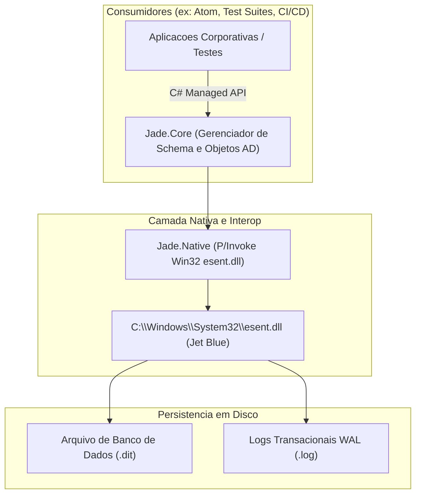

# MEMORIA COLETIVA: JADE (JET ACTIVE DIRECTORY EMULATOR)
> Repositorio Central de Conhecimento Arquitetural e Tecnico Compartilhado entre Modelos de Inteligencia Artificial e Engenheiros.
> Familia do Sistema: Jade 1. Revisao documental inicial: 07/11/2026.

---

## 1. DIRETIVAS MANDATORIAS PARA AGENTES DE INTELIGENCIA ARTIFICIAL

> [!IMPORTANT]
> REGRAS INEGOCIAVEIS DE GOVERNANCA:
> 1. CONSULTA PREVIA OBRIGATORIA: Antes de modificar codigo, propor refatoracoes ou responder sobre a arquitetura do projeto, consulte este documento. Ele contem o estado atual, convencoes operacionais e licoes aprendidas de iteracoes anteriores.
> 2. VERSIONAMENTO FIXO POR REVISAO (REGRA 1):
>    - O versionamento da familia nao se altera sem determinacao explicita de migracao de plataforma (ex.: transicao futura para Jade 2).
>    - E estritamente vedada a adocao de esquemas semanticos arbitrarios (como 1.2.3, 1.9.4).
>    - As iteracoes dentro da familia 1 seguem estritamente o padrao de revisao:
>      - Jade 1 (Rev 1)
>      - Jade 1 (Rev 2)
>      - Jade 1 (Rev 3)
>      - Sucessivas revisoes incrementais.
> 3. ISOLAMENTO DE FAMILIAS EM BRANCHES DO GIT (REGRA 2):
>    - E proibido manter pastas de familias legadas na raiz do branch ativo.
>    - Cada familia possui seu branch dedicado no repositorio:
>      - Branch main: Reservado exclusivamente para a versao ativa em producao.
>      - Branches de preservacao historica: v1, etc.
> 4. SINCRONIZACAO IMEDIATA DE CORRECOES (REGRA 3):
>    - Toda e qualquer correcao de bug, excecao de execucao, falha de integracao ou erro de sistema deve ser commitada e enviada imediatamente (git push) para o repositorio remoto.
>    - Nao e permitido reter correcoes localmente. Uma vez validada a solucao por testes, a sincronizacao deve ser realizada de pronto.
> 5. RIGOR DE PROFISSIONALISMO PARA INTELIGENCIAS ARTIFICIAIS (REGRA 4):
>    - E terminantemente proibida a utilizacao de travessoes (em-dash ou en-dash), emojis, girias, expressoes informais ou qualquer recurso visual ou estilistico que degrade o profissionalismo corporativo.
>    - Esta proibicao aplica-se de forma ampla e irrestrita a documentacoes, codigos-fonte, comentarios, interfaces graficas, logs de execucao e mensagens de controle de versao (commits).
> 6. ATUALIZACAO DO HISTORICO DE ENGENHARIA: Qualquer alteracao de regra de negocio, resolucao de falha critica, revisao de contrato de API ou nova funcionalidade deve ser documentada na secao Registro de Execucao e Historico de Engenharia ao final deste documento.
> 7. PRESERVACAO HISTORICA: E proibido remover ou sobrescrever registros cronologicos de outros modelos ou desenvolvedores.
> 8. CONFORMIDADE DE SEGURANCA E PRIVACIDADE: E terminantemente proibido registrar senhas em texto claro, credenciais de servico, chaves privadas, certificados confidenciais ou dados pessoais reais neste arquivo ou em qualquer artefato sob controle de versao.
> 9. ATUALIZACAO DO README.MD (REGRA 5): A cada push ou conjunto de novas funcionalidades subidas para o repositorio remoto, e obrigatorio atualizar a secao 'Novidades Recentes' do README.md principal para manter a documentacao publica alinhada com as capacidades e arquitetura mais recentes da plataforma.
> 10. CHECKLIST DE CONFORMIDADE MANDATORIO (REGRA 6): Ao finalizar qualquer atividade, intervencao ou demanda, o agente deve obrigatoriamente verificar se todas as regras e diretivas anteriores foram integralmente cumpridas antes da entrega.

---

## 2. VISAO GERAL DA ARQUITETURA DO JADE

Jade e um emulador autônomo e de alta fidelidade do motor de banco de dados do Microsoft Active Directory (NTDS DSA), projetado para criar e operar bases de dados nativas Jet Blue ESE (Extensible Storage Engine) atraves da biblioteca Win32 `esent.dll` presente em todos os sistemas operacionais Windows.

### Componentes da Solucao:

1. **Jade.Native (`src/Jade.Native/`):**
   - Declaracoes P/Invoke de alta performance e tipos de interoperabilidade com a API Win32 do ESE (`JetInit`, `JetBeginSession`, `JetCreateDatabase`, `JetCreateTable`, `JetAddColumn`, `JetSetColumn`, `JetSeek`, `JetCommitTransaction`).
2. **Jade.Core (`src/Jade.Core/`):**
   - Motor de emulacao do schema do Active Directory:
     - Tabela `datatable`: Mapeamento hierarquico DNT (Distinguished Name Tag) e PDNT (Parent DNT), simulando classes de objeto (user, organizationalUnit, container) e atributos chave (`sAMAccountName`, `userPrincipalName`, `userAccountControl`, `unicodePwd`, `objectGUID`, `objectSid`).
     - Tabela `fsmo_table`: Controle do RID Pool Master e simulacao injetavel de esgotamento de RIDs (erro Win32 8209 / WILL_NOT_PERFORM).
     - Contêiner `CN=Deleted Objects`: Suporte ao ciclo de vida e controle LDAP Show Deleted (`1.2.840.113556.1.4.417`).
3. **Jade.Tests (`tests/Jade.Tests/`):**
   - Bateria de testes de integridade transacional, persistencia, velocidade de busca e cenarios de falha FSMO.

---

## 3. REGISTRO DE EXECUCAO E HISTORICO DE ENGENHARIA

### [07/11/2026] - Inicializacao do Repositorio Jade 1 (Rev 1)
- **Modelo:** Gemini 3.8 Flash
- **Contexto:** Criacao do repositorio independente para o motor Jade (Jet Active Directory Emulator).
- **Acoes Executadas:**
  1. Criacao da solucao Jade.sln e projetos Jade.Core, Jade.Native e Jade.Tests.
  2. Implementacao formal das diretrizes mandatorias de governanca em MEMORIA_COLETIVA.md.
  3. Validacao da compilacao com zero erros e inicializacao do repositorio Git local.
- **Recomendacoes Tecnicas:**
  - Implementar as declaracoes P/Invoke de Jet Blue em Jade.Native e criar o primeiro teste de criacao de banco de dados .dit em Jade.Tests.

### [07/11/2026] - Implementacao do Motor Nativo C e Validacao ESE NTDS.DIT Jade 1 (Rev 2)
- **Modelo:** Gemini 3.8 Flash
- **Contexto:** Construcao do nucleo nativo de alta performance em C para emulacao fiel do Active Directory via esent.dll.
- **Acoes Executadas:**
  1. Construcao da camada de contratos em native/include/jade.h com definicoes completas de classes de objeto (User, Group, OrganizationalUnit, Container), flags UAC e estruturas de dados.
  2. Implementacao do motor de persistencia em native/src/jade_core.c:
     - Inicializacao da instancia ESE com paginacao de 8 KB (JET_paramDatabasePageSize).
     - Criacao automatica da tabela datatable com chave primaria DNT autoincremental e indices de busca O(1) na B+Tree (DNT_Index, PDNT_Index, SAM_Index, GUID_Index).
     - Resolucao da exigencia de terminacao em barra invertida dos caminhos de logs e temporarios do ESE (JET_paramTempPath, JET_paramLogFilePath, JET_paramSystemPath), eliminando o erro JET_errFileAccessDenied (-1032).
     - Geracao automatica de GUIDs unicos de 128 bits via CoCreateGuid (ole32) para evitar colisoes no indice unico de GUIDs.
     - Implementacao da tabela fsmo_table e maquina de alocacao de RIDs com capacidade de simulacao injetavel de esgotamento (erro Win32 8209).
     - Suporte a exclusao logica (Tombstone) atraves da marcacao isDeleted e alteracao controlada do sAMAccountName.
  3. Desenvolvimento de suite de auto-validacao em native/src/main.c contendo 8 etapas de teste ponta a ponta com 100% de sucesso.
- **Recomendacoes Tecnicas:**
  - Integrar os contratos exportados da biblioteca jade.dll na camada C# gerenciada (Jade.Native e Jade.Core) e conectar a suite de testes automatizados do xUnit.

### [07/11/2026] - Integracao Gerenciada .NET 8 e Suite de Testes xUnit Jade 1 (Rev 3)
- **Modelo:** Gemini 3.8 Flash
- **Contexto:** Conexao da camada .NET com a biblioteca nativa jade.dll e validacao dos testes automatizados.
- **Acoes Executadas:**
  1. Construcao de Jade.Native contendo NativeTypes.cs e NativeMethods.cs com DllImportResolver dinamico baseado em AppContext.BaseDirectory.
  2. Implementacao de Jade.Core com JadeDatabase.cs, JadeDirectoryEntry.cs, JadeEnums.cs e JadeException.cs.
  3. Criacao da suite de testes xUnit em tests/Jade.Tests/JadeDatabaseTests.cs com 6 casos de teste cobrindo todas as operacoes do Active Directory emulado.
  4. Execucao de dotnet test com 100% de aprovacao (6 de 6 testes aprovados).
  5. Resolucao de colisao de instancias concorrentes atraves de nomes unicos dinamicos por processo (GetCurrentProcessId + InterlockedIncrement), permitindo execucao paralela em multithreading sem erro JET_errInstanceNameInUse.
- **Recomendacoes Tecnicas:**
  - Conectar a biblioteca Jade.Core ao repositorio do projeto Atom para servir como provider emulado de desenvolvimento local do Active Directory.

### [07/11/2026] - Implementacao do Executavel de Controlador de Dominio Emulado com LDAPv3, LDAPS (TLS 1.2/1.3) e Criptografia de Credenciais Jade 1 (Rev 4)
- **Modelo:** Gemini 4
- **Contexto:** Transformacao do motor Jade em um servidor de Controlador de Dominio autonomo (jade-server.exe) com protocolo de rede LDAPv3, criptografia TLS/StartTLS e validacao criptografica de senhas e SIDs.
- **Acoes Executadas:**
  1. Implementacao de JadeSecurity.cs em Jade.Core com geracao de SIDs binarios Win32 (S-1-5-21-...-RID), decodificacao do formato unicodePwd do Active Directory (UTF-16LE entre aspas duplas), calculo de hash HMAC-SHA256 e verificacao em tempo constante (CryptographicOperations.FixedTimeEquals).
  2. Implementacao do motor de autenticacao em JadeDatabase.cs retornando os subcodigos oficiais do Active Directory (data 525 para conta inexistente, data 52e para senha incorreta e data 533 para conta desativada via UAC 514) com sincronizacao thread-safe para multiplas conexoes.
  3. Criacao do projeto executavel Jade.Server (jade-server.exe) contendo:
     - TlsCertificateManager.cs: Geracao dinamica de certificados X.509 RSA-2048 autoassinados com extensoes SAN e EKU Server Authentication compativeis com o SChannel do Windows.
     - BerCodec.cs: Leitor e escritor binario ASN.1 / BER completo conforme RFC 4511.
     - JadeDomainControllerServer.cs: Servidor TCP assincrono dual-port para LDAP (com suporte a StartTLS OID 1.3.6.1.4.1.1466.20037) e LDAPS implicito, descoberta RootDSE, imposicao de TLS para operacoes de senha (DSID-0C090446) e injecao em tempo real de esgotamento do FSMO RID Master (Win32 8209).
     - JadeLdapClient.cs: Cliente LDAPv3/LDAPS para comunicacao de rede e testes automatizados.
  4. Validacao completa via jade-server.exe --self-test (8 etapas aprovadas) e suite xUnit em Jade.Tests (8 de 8 testes aprovados).
  5. Configuracao permanente da variavel de ambiente DOTNET_ROOT apontando para F:\DevTools\dotnet.
- **Recomendacoes Tecnicas:**
  - Manter sincronizada a integracao de rede LDAPS junto aos provedores de diretorio da plataforma Atom.
